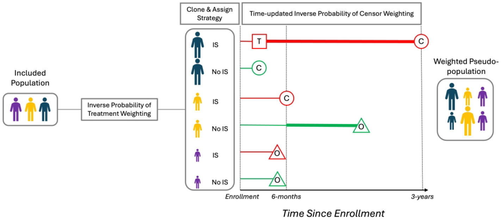
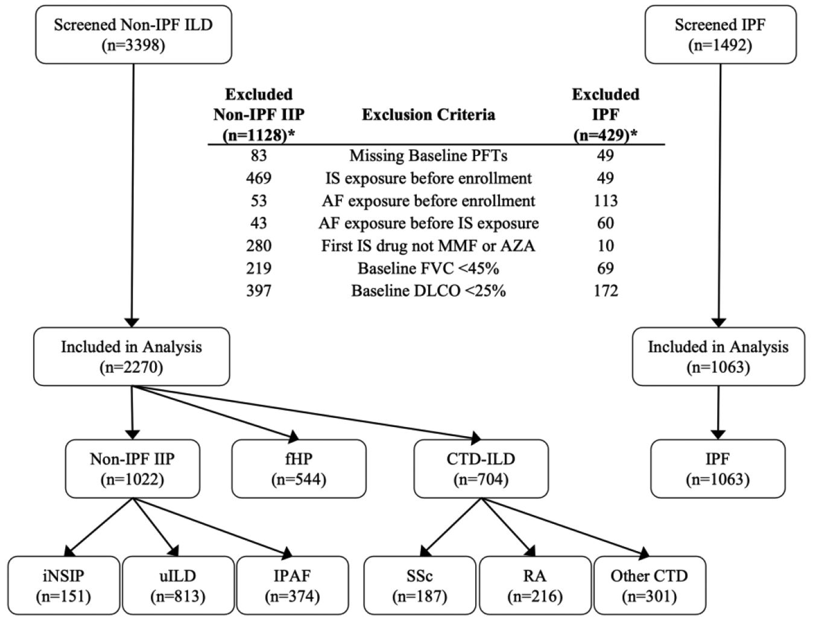
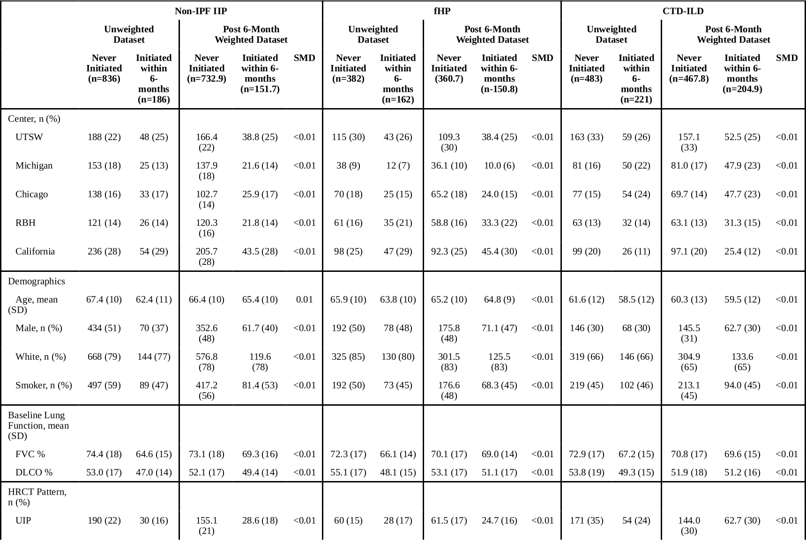
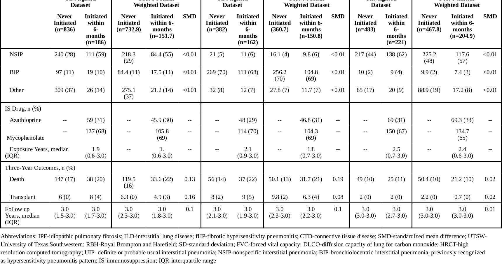
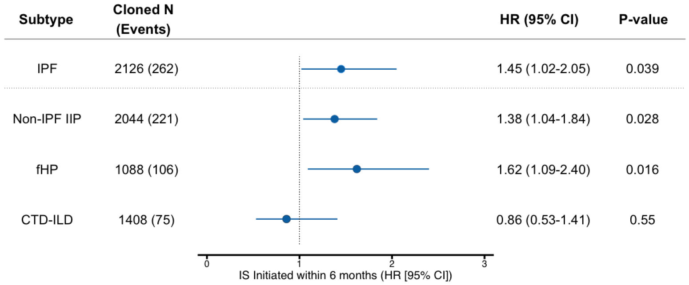
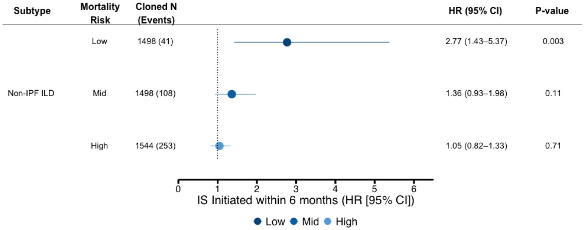
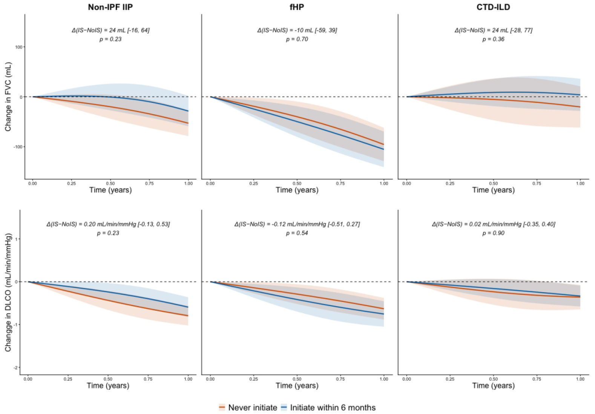

# Mycophenolate and Azathioprine in Fibrotic Interstitial Lung Disease
# 吗替麦考酚酯与硫唑嘌呤在纤维化型间质性肺病中的应用（中英对照阅读版）

| 项目 | 内容 |
|---|---|
| 作者 | Janelle Vu Pugashetti†, Adelle S. Jee†, Andrew R. Yu, Noor Hammoud, Felix Chua, Leda Yazbeck, Cathryn T. Lee, Gabrielle Y. Liu, Traci N. Adams, Ayodeji Adegunsoye, Paul J. Wolters, Dinesh Khanna, Mary E. Strek, Justin M. Oldham, Philip L. Molyneaux, Chad A. Newton（†共同第一作者） |
| 期刊 | *Am J Respir Crit Care Med* 2026; 212(10): 2493–2503 |
| DOI | [10.1093/ajrccm/aamag362](https://doi.org/10.1093/ajrccm/aamag362) |
| 来源文件 | 用户上传的 PMC 作者手稿版 PDF（Author manuscript，22 页） |
| 文章类型 | 多中心回顾性观察研究（目标试验模拟 / 方法学驱动的临床疗效研究） |
| 阅读版说明 | 段落级英中对照；块编号 S/F/T 与 `source_map.json` 一致；页码为 PDF 页码 |

## 目录 / Section index

- [摘要 Abstract](#abstract) · p.1–2
- [引言 Introduction](#introduction) · p.3
- [方法 Methods](#methods) · p.3–6
- [结果 Results](#results) · p.6–7
- [讨论 Discussion](#discussion) · p.8–10
- [结论 Conclusion](#conclusion) · p.10
- [资助与披露](#funding) · p.11
- [图表索引](#figindex) · p.16–22
- [术语表](#glossary)
- [阅读提示](#notes)
- [参考文献](#references) · p.11–15

**图表索引：** [Fig. 1](#F001) 研究设计 · [Fig. 2](#F002) STROBE 流程 · [Fig. 3](#F003) 生存主结果 · [Fig. 4](#F004) 风险分层 · [Fig. 5](#F005) 肺功能轨迹 · [Table 1](#T001) 基线特征

---

## Abstract ｜ 摘要

*Source: p.1 S001*

**Source:** p.1 S002

**Original:** Rationale: Immunosuppression is routinely used for non–idiopathic pulmonary fibrosis (IPF) interstitial lung diseases (ILDs), despite limited trial evidence and unclear impact on long-term outcomes.

**中文:** 研究依据：免疫抑制治疗在非特发性肺纤维化（IPF）的间质性肺病（ILD）中被常规使用，但相关试验证据有限，其对长期结局的影响也不明确。

**Source:** p.2 S003

**Original:** Objectives: To evaluate whether mycophenolate or azathioprine improves three-year transplant-free survival and lung function trajectory in fibrotic ILD, including non-IPF idiopathic interstitial pneumonia (IIP), fibrotic hypersensitivity pneumonitis (fHP), and connective-tissue disease (CTD) associated ILD.

**中文:** 研究目的：评估吗替麦考酚酯（mycophenolate）或硫唑嘌呤（azathioprine）能否改善纤维化型 ILD 患者的三年无移植生存率及肺功能变化轨迹，研究人群包括非 IPF 特发性间质性肺炎（IIP）、纤维化型过敏性肺炎（fHP）和结缔组织病（CTD）相关 ILD。

**Source:** p.2 S004

**Original:** Methods: We employed a clone-censor-weighting framework to emulate a randomized controlled trial in this multi-center retrospective study. Each patient was cloned and assigned to immunosuppression initiation within 6 months of enrollment or no initiation strategies, and censored when the assigned strategy deviated from observed treatment. Stabilized inverse probability treatment and censoring weights were used.

**中文:** 方法：本项多中心回顾性研究采用克隆–删失–加权（clone-censor-weighting）框架来模拟一项随机对照试验。每例患者被克隆，分别分配到“入组后 6 个月内启动免疫抑制”和“不启动”两种策略；当所分配策略与实际观察到的治疗不符时予以删失。分析使用了稳定化的逆概率处理权重和逆概率删失权重。

**Source:** p.2 S005

**Original:** Measurements: The primary endpoint was three-year transplant-free survival assessed with weighted Cox models across treatment strategies. Weighted generalized estimating equations were used to model lung function trajectory.

**中文:** 测量指标：主要终点为三年无移植生存，采用加权 Cox 模型在不同治疗策略间进行评估。肺功能变化轨迹采用加权广义估计方程建模。

**Source:** p.2 S006

**Original:** Main Results: Among 2,270 included patients, 18% (186/1022) with non-IPF IIP, 30% (162/544) with fHP, and 31% (221/704) with CTD-ILD were initiated on immunosuppression within 6-months. Immunosuppression was not associated with improved survival within any ILD subtype but was associated with worse survival in non-IPF IIP (HR 1.38, 95% CI 1.04-1.84) and fHP (HR 1.62, 95% CI 1.09-2.40). Immunosuppression was not associated with differential lung function trajectory within any ILD subtype.

**中文:** 主要结果：在纳入的 2,270 例患者中，非 IPF IIP 患者有 18%（186/1022）、fHP 患者有 30%（162/544）、CTD-ILD 患者有 31%（221/704）在 6 个月内启动了免疫抑制治疗。在任何 ILD 亚型中，免疫抑制均未与生存改善相关；相反，在非 IPF IIP（HR 1.38，95% CI 1.04–1.84）和 fHP（HR 1.62，95% CI 1.09–2.40）中与更差的生存相关。在任何 ILD 亚型中，免疫抑制均未与肺功能变化轨迹的差异相关。

**Source:** p.2 S007

**Original:** Conclusions: In this study, immunosuppression initiation showed no evidence of benefit for three-year transplant-free survival or lung function and was associated with higher mortality in select fibrotic ILD subtypes. Prospective randomized controlled trials are needed to inform patient care.

**中文:** 结论：在本研究中，启动免疫抑制治疗未显示出对三年无移植生存或肺功能有获益的证据，且在部分纤维化型 ILD 亚型中与更高的死亡率相关。需要前瞻性随机对照试验来指导患者诊疗。

### At a Glance Commentary ｜ 要点速览

*Source: p.2 S008*

**Source:** p.2 S009

**Original:** Scientific Knowledge on the Subject: Immunosuppressant therapy with mycophenolate or azathioprine is commonly prescribed for fibrotic interstitial lung diseases (ILDs) including non-idiopathic pulmonary fibrosis (IPF) idiopathic interstitial pneumonia, fibrotic hypersensitivity pneumonitis, and connective tissue disease-associated ILD (CTD-ILD). This practice is largely derived from retrospective observational studies, which carries inherent biases. While there are data that immunosuppressant therapy improves lung function in subsets of patients with CTD-ILD, the effect of immunosuppressant therapy on survival remains uncertain.

**中文:** 该领域已有认识：吗替麦考酚酯或硫唑嘌呤免疫抑制治疗常用于纤维化型间质性肺病（ILD），包括非特发性肺纤维化（IPF）的特发性间质性肺炎、纤维化型过敏性肺炎以及结缔组织病相关 ILD（CTD-ILD）。这一做法主要来源于回顾性观察研究，而此类研究存在固有偏倚。虽然已有数据显示免疫抑制治疗可改善部分 CTD-ILD 患者的肺功能，但其对生存的影响仍不确定。

**Source:** p.2 S010

**Original:** What This Study Adds to the Field: Using a robust clone-censor-weighting design to emulate a randomized clinical trial, this multicenter retrospective study of 2270 patients with non-IPF ILD found no evidence that initiating mycophenolate or azathioprine improved three-year transplant-free survival or lung function trajectory in any ILD subtype studied. Instead, immunosuppressant therapy was associated with worse survival in patients with non-IPF idiopathic interstitial pneumonia and fibrotic hypersensitivity pneumonitis. These findings challenge routine use of immunosuppressant therapy in these populations and underscore the urgent need for prospective randomized controlled trials to clarify its role in guiding treatment decisions for fibrotic ILD.

**中文:** 本研究的新贡献：这项纳入 2270 例非 IPF ILD 患者的多中心回顾性研究，采用稳健的克隆–删失–加权设计来模拟随机临床试验，结果在所研究的任何 ILD 亚型中，均未发现启动吗替麦考酚酯或硫唑嘌呤能改善三年无移植生存或肺功能变化轨迹的证据。相反，在非 IPF 特发性间质性肺炎和纤维化型过敏性肺炎患者中，免疫抑制治疗与更差的生存相关。这些发现对在上述人群中常规使用免疫抑制治疗提出了挑战，并凸显了开展前瞻性随机对照试验、以明确其在纤维化型 ILD 治疗决策中作用的迫切性。

## Introduction ｜ 引言

*Source: p.3 S011*

**Source:** p.3 S012

**Original:** Interstitial lung disease (ILD) comprises a heterogeneous group of lung disorders characterized by variable degrees of fibrosis and inflammation, which results in unpredictable disease trajectories and limited clarity around optimal treatment. Although multiple randomized trials have defined effective and harmful therapies for idiopathic pulmonary fibrosis (IPF),(1-4) comparable high-quality evidence is lacking for other ILDs, including non-IPF idiopathic interstitial pneumonia (IIP), fibrotic hypersensitivity pneumonitis (fHP), and most subtypes of connective tissue disease–associated ILD (CTD-ILD). Nintedanib and nerandomilast have been shown to slow lung function decline in progressive ILD, but approval and coverage generally require disease progression.(5, 6) In an effort to prevent progression, these conditions are often treated with immunosuppression, yet the benefit outside of CTD-ILD remains uncertain.(7)

**中文:** 间质性肺病（ILD）是一组异质性的肺部疾病，以不同程度的纤维化和炎症为特征，导致疾病进程难以预测，最佳治疗方案也不够明确。尽管多项随机试验已经明确了特发性肺纤维化（IPF）中有效和有害的疗法，(1-4) 但对于其他 ILD——包括非 IPF 特发性间质性肺炎（IIP）、纤维化型过敏性肺炎（fHP）以及大多数结缔组织病相关 ILD（CTD-ILD）亚型——仍缺乏同等质量的证据。尼达尼布（nintedanib）和 nerandomilast 已被证明可延缓进展性 ILD 的肺功能下降，但其获批适应证和医保覆盖通常要求疾病已经进展。(5, 6) 为防止疾病进展，这些疾病常采用免疫抑制治疗，但除 CTD-ILD 外，其获益仍不确定。(7)

**Source:** p.3 S013

**Original:** In the absence of randomized trials, treatment effects are frequently inferred from observational data, but such analyses are vulnerable to confounding by indication, immortal-time bias, and selection bias.(8) Target trial emulation provides the framework to address these challenges by explicitly defining the protocol of an ideal randomized controlled trial (RCT) that would answer the research question, then using observational data to emulate that trial, thereby reducing the biases inherent in traditional observational analyses.(9) Clone-censor-weighting (CCW) operationalizes this framework by assigning patients to eligible treatment strategies at baseline, censoring deviations, and applying inverse probability weights to create a pseudo-population in which treatment is independent of prognosis.(10, 11) This approach mitigates biases from time-dependent treatment decisions and yields more interpretable estimates of real-world treatment effects.

**中文:** 在缺乏随机试验的情况下，治疗效果常从观察性数据中推断，但此类分析容易受到适应证混杂、不朽时间偏倚（immortal-time bias）和选择偏倚的影响。(8) 目标试验模拟（target trial emulation）为应对这些问题提供了框架：先明确定义一项能回答该研究问题的理想随机对照试验（RCT）方案，再用观察性数据去模拟这项试验，从而减少传统观察性分析固有的偏倚。(9) 克隆–删失–加权（CCW）是实现这一框架的具体方法：在基线时将患者分配到其符合条件的各治疗策略中，对偏离策略者进行删失，并应用逆概率权重构建一个“伪人群”，使治疗与预后相互独立。(10, 11) 这种方法可减轻由随时间变化的治疗决策带来的偏倚，并得到更易解释的真实世界治疗效果估计。

**Source:** p.3 S014

**Original:** Using CCW, we emulated a per-protocol trial to evaluate whether immunosuppression (mycophenolate or azathioprine) improves survival or lung function trajectory in fibrotic ILD subtypes for which immunosuppression is commonly employed and included a similarly constructed IPF cohort as a comparator given the established harm of immunosuppression in IPF.

**中文:** 我们使用 CCW 模拟了一项符合方案（per-protocol）试验，以评估免疫抑制（吗替麦考酚酯或硫唑嘌呤）能否改善那些常规使用免疫抑制的纤维化型 ILD 亚型的生存或肺功能变化轨迹；鉴于免疫抑制在 IPF 中的危害已被证实，我们还以相同方式构建了一个 IPF 队列作为对照。

## Methods ｜ 方法

*Source: p.3 S015*

### Observed Study Populations and Eligibility Criteria ｜ 观察研究人群与入选标准

*Source: p.3 S016*

**Source:** p.3 S017

**Original:** Patients with non-IPF fibrotic ILD were retrospectively identified from registries at the University of California, San Francisco and Davis (California, 2006–2020), University of Texas Southwestern (UTSW, 2006–2020), University of Michigan (2006–2019), University of Chicago (2006–2020), and Royal Brompton & Harefield Hospitals (RBH, 2009–2014). Institutional review boards at each U.S. participating center approved the protocol (UCSF #10-01592 and #10-00198; UCD #928979; UTSW #092017-007 and #2021-0598; Chicago #13-1180; and Michigan HUM00105694) and UK approval for the study was obtained from the local Research Ethics Committee (19/LO/1879).

**中文:** 非 IPF 纤维化型 ILD 患者经回顾性方式从以下登记库中识别：加州大学旧金山分校和戴维斯分校（California，2006–2020）、德克萨斯大学西南医学中心（UTSW，2006–2020）、密歇根大学（2006–2019）、芝加哥大学（2006–2020）以及皇家布朗普顿与哈尔菲尔德医院（RBH，2009–2014）。美国各参与中心的机构审查委员会批准了研究方案（UCSF #10-01592 与 #10-00198；UCD #928979；UTSW #092017-007 与 #2021-0598；Chicago #13-1180；Michigan HUM00105694），英国部分的研究获得当地研究伦理委员会批准（19/LO/1879）。

**Source:** p.3 S018

**Original:** Eligible patients had clinical and high resolution computed tomography (HRCT) data to support a multidisciplinary diagnosis of non-IPF fibrotic IIP, fHP, or CTD-ILD using accepted criteria.(7, 12, 13) Additional inclusion criteria were: baseline HRCT confirming fibrosis and imaging pattern as determined at each site, baseline forced vital capacity (FVC) ≥40% predicted and diffusing capacity for carbon monoxide (DLCO) ≥25% predicted, and known death or transplant status within three years of enrollment. Patients were excluded if they received mycophenolate, azathioprine, or antifibrotics (nintedanib, pirfenidone) before registry enrollment or were treated with antifibrotics prior to immunosuppression. Given that mycophenolate and azathioprine are the most used immunosuppressants in our ILD cohorts, patients initially exposed to other immunosuppressants (including rituximab and cyclophosphamide) were excluded. A comparator cohort of patients with a multi-disciplinary diagnosis of IPF was assembled using the same inclusion and exclusion criteria.

**中文:** 符合条件的患者需具备临床和高分辨率计算机断层扫描（HRCT）资料，可依据公认标准支持非 IPF 纤维化型 IIP、fHP 或 CTD-ILD 的多学科诊断。(7, 12, 13) 其他纳入标准包括：基线 HRCT 证实存在纤维化，影像学类型由各中心判定；基线用力肺活量（FVC）≥ 预计值的 40%，一氧化碳弥散量（DLCO）≥ 预计值的 25%；入组后三年内的死亡或移植状态已知。若患者在登记入组前已接受吗替麦考酚酯、硫唑嘌呤或抗纤维化药物（尼达尼布、吡非尼酮），或在免疫抑制之前接受过抗纤维化治疗，则予以排除。鉴于吗替麦考酚酯和硫唑嘌呤是本研究 ILD 队列中最常用的免疫抑制剂，初始暴露于其他免疫抑制剂（包括利妥昔单抗和环磷酰胺）的患者亦被排除。采用相同的纳入与排除标准，组建了一个经多学科诊断为 IPF 的对照队列。

### Clinical Covariates and Outcomes ｜ 临床协变量与结局

*Source: p.4 S019*

**Source:** p.4 S020

**Original:** Dates of exposure to ILD-directed medications including mycophenolate, azathioprine, pirfenidone, and nintedanib were abstracted from the medical records from each site. Immunosuppressant exposure was defined as initiation of mycophenolate or azathioprine within 6 months of registry enrollment. For patients treated sequentially with mycophenolate or azathioprine, the first drug was considered primary for descriptive summaries and drug-specific analyses. Pirfenidone and nintedanib were not considered treatment exposures in the target trial but were handled as exclusion criteria at baseline or censoring events during follow up. Clinical covariates included age, sex, race and ethnicity, smoking history, FVC and DLCO percent predicted, enrollment year, and HRCT pattern.

**中文:** 针对 ILD 的药物（包括吗替麦考酚酯、硫唑嘌呤、吡非尼酮和尼达尼布）的暴露日期均从各中心的病历中摘录。免疫抑制剂暴露定义为登记入组后 6 个月内启动吗替麦考酚酯或硫唑嘌呤。对于先后使用吗替麦考酚酯和硫唑嘌呤的患者，在描述性汇总和药物特异性分析中以首用药物为主。吡非尼酮和尼达尼布在目标试验中不被视为治疗暴露，而是作为基线排除标准或随访期间的删失事件处理。临床协变量包括年龄、性别、种族与族裔、吸烟史、FVC 和 DLCO 占预计值百分比、入组年份以及 HRCT 类型。

**Source:** p.4 S021

**Original:** The primary outcome was death or lung transplant within 3 years of enrollment. This timeframe was chosen to allow sufficient follow-up time to capture survival differences and adequate time for immunosuppressant titration and effect, while avoiding excessively long follow-up susceptible to unrelated intervening factors. Serial absolute FVC and DLCO values through three years were collected, with DLCO measurements excluded when the maneuver could not be completed for any reason. No imputation was performed for missing data.

**中文:** 主要结局为入组后 3 年内死亡或肺移植。选择这一时间窗，是为了留出足够的随访时间来捕捉生存差异，并为免疫抑制剂的剂量滴定和起效提供充分时间，同时避免过长随访受到无关干扰因素的影响。研究收集了三年内连续的 FVC 和 DLCO 绝对值；凡因任何原因未能完成检查动作的 DLCO 测量均予以剔除。缺失数据未做插补。

### Clone–Censor–Weighting Framework ｜ 克隆–删失–加权框架

*Source: p.4 S022*

**Source:** p.4 S023

**Original:** We applied target clinical trial emulation framework using a clone-censor weighting (CCW) approach, comparing the effect of mycophenolate or azathioprine initiation within 6 months of enrollment compared to no initiation within this window among patients with non-IPF fibrotic ILD. The specifications for the emulated targeted trial are presented in Table E1, and study design is depicted in Figure 1.

**中文:** 我们采用克隆–删失–加权（CCW）方法实施目标临床试验模拟框架，在非 IPF 纤维化型 ILD 患者中比较入组后 6 个月内启动吗替麦考酚酯或硫唑嘌呤与在该时间窗内不启动的效果。所模拟目标试验的具体设定见表 E1，研究设计见图 1。

### Fig. 1  克隆–删失–加权研究设计示意

**Placed near:** p.4 S023  
**Source:** p.16 C001

**Original caption:** Figure 1: Study overview demonstrating clone-censor-weighting design. Size of patient figures and line thickness represents relative contribution to pseudo-population resulting from inverse probability of treatment weighting and inverse probability of censor weighting. Squares represent immunosuppression initiation; circles represent censoring; triangles represent death or transplant outcomes. Abbreviations: IS-immunosuppression

**中文图注:** 图 1：研究概览，展示克隆–删失–加权设计。患者图形的大小与连线粗细表示经逆概率处理加权和逆概率删失加权后，各患者对伪人群的相对贡献。方块表示启动免疫抑制；圆圈表示删失；三角形表示死亡或移植结局。缩写：IS——免疫抑制。

**Reading note:** 看每例患者如何被复制成两个克隆体：一个进入“6 个月内启动 IS”组，一个进入“不启动”组；实际治疗与所分配策略不符时，该克隆体被删失（圆圈），其余克隆体的权重相应放大（图形变大、线条变粗）。

**Source:** p.4 S024

**Original:** The CCW framework requires three steps: cloning, censoring, and weighting. First, all included patients were cloned while retaining baseline characteristics; one clone was assigned to the initiate immunosuppression within 6 months strategy, and the other clone was assigned no immunosuppressant initiation. Second, artificial censoring was performed when the clone deviated from their assigned strategy within the 6-month treatment window, representing the point at which an individual’s observed treatment trajectory becomes incompatible with their assigned strategy. Switching between mycophenolate and azathioprine was not considered a deviation from the class-level immunosuppression strategy. Each clone was then followed from enrollment until the earliest occurrence of death, lung transplantation, administrative censoring at initiation of antifibrotic or end of three years, or artificial censoring due to deviation from the assigned strategy. Third, we performed weighting separately within each center and fibrotic ILD subtype. To account for confounding by indication, inverse probability of treatment weighting (IPTW) using propensity scores was employed, adjusting for baseline covariates (age at enrollment, sex, non-Hispanic White ethnicity, smoking history [ever/never], baseline FVC and DLCO percent predicted, HRCT usual interstitial pneumonia (UIP) pattern [present/absent], and enrollment year). To mitigate selection bias from artificial censoring, time-updated stabilized inverse probability of censoring weights (IPCW) were also derived, modeled using Cox regression with censoring as the event. To account for potential informative administrative censoring due to antifibrotic initiation, time to antifibrotic initiation was also included as a covariate in the IPCW models. The final weight used for each clone was computed as the product of the baseline IPTW and the time-updated IPCW. This joint weight represented the probability of receiving the assigned treatment strategy and remaining uncensored under that strategy, thereby creating a pseudo-population in which all individuals adhere to their assigned strategy throughout follow-up.(10, 14) For the longitudinal lung function trajectory analyses, the time-updated IPCW also included adherence and visit observation indicators to account for informative missingness of FVC or DLCO measurements and analyses were restricted to uncensored, strategy compliant three-year follow up.

**中文:** CCW 框架包含三个步骤：克隆、删失和加权。第一，所有纳入患者均被克隆并保留其基线特征；一个克隆体被分配到“6 个月内启动免疫抑制”策略，另一个克隆体被分配到“不启动免疫抑制”策略。第二，当克隆体在 6 个月治疗窗内偏离其被分配的策略时进行人为删失，该时间点代表个体实际治疗轨迹与所分配策略不再相容。在吗替麦考酚酯与硫唑嘌呤之间换药不被视为偏离药物类别层面的免疫抑制策略。随后，每个克隆体从入组开始随访，直至最早发生以下事件之一：死亡、肺移植、因启动抗纤维化药物或满三年而发生的管理性删失，或因偏离所分配策略而发生的人为删失。第三，我们在每个中心和每个纤维化型 ILD 亚型内部分别进行加权。为处理适应证混杂，采用基于倾向评分的逆概率处理加权（IPTW），校正的基线协变量包括入组年龄、性别、非西班牙裔白人族裔、吸烟史［曾吸/从不］、基线 FVC 和 DLCO 占预计值百分比、HRCT 普通型间质性肺炎（UIP）类型［有/无］以及入组年份。为减轻人为删失导致的选择偏倚，还推导了随时间更新的稳定化逆概率删失权重（IPCW），以删失为事件、采用 Cox 回归建模。为处理因启动抗纤维化药物可能导致的信息性管理删失，IPCW 模型还纳入了至启动抗纤维化药物的时间作为协变量。每个克隆体的最终权重为基线 IPTW 与随时间更新的 IPCW 之积。该联合权重代表接受所分配治疗策略并在该策略下保持未删失的概率，从而构建一个所有个体在整个随访期间都遵循其所分配策略的伪人群。(10, 14) 在纵向肺功能轨迹分析中，随时间更新的 IPCW 还纳入了依从性和就诊观测指示变量，以处理 FVC 或 DLCO 测量的信息性缺失，且分析仅限于未删失、遵循策略的三年随访数据。

**Source:** p.5 S025

**Original:** Robustness of the CCW process was assessed by examining distribution of propensity scores, IPTW, and IPCW as well as covariate balance, defined as absolute standardized mean difference <0.1 indicating adequate confounder balance, for each weighting step.(15) We also assessed effective sample size (ESS) compared to cloned sample size to estimate degree of data loss from artificial censoring.(16)

**中文:** 通过考察每一加权步骤中倾向评分、IPTW 和 IPCW 的分布以及协变量平衡情况（以标准化均值差绝对值 <0.1 表示混杂因素充分平衡），评估 CCW 过程的稳健性。(15) 我们还将有效样本量（ESS）与克隆后样本量进行比较，以估计人为删失造成的数据损失程度。(16)

### Statistical Analyses ｜ 统计分析

*Source: p.5 S026*

**Source:** p.5 S027

**Original:** All contrasts represented a per-protocol effect, which estimates the impact of immunosuppression initiation within 6 months that would have been observed if all patients adhered to the assigned treatment strategy.(17) For all outcome models, centers were pooled within fibrotic subtypes while retaining the center-specific weights to account for center-level treatment and covariate heterogeneity.

**中文:** 所有比较均代表符合方案效应，即估计在所有患者都遵循所分配治疗策略的情况下，6 个月内启动免疫抑制所能观察到的影响。(17) 在所有结局模型中，各中心在纤维化亚型内合并分析，同时保留中心特异性权重，以考虑中心层面治疗方式与协变量的异质性。

**Source:** p.5 S028

**Original:** The primary analysis estimated the effect of initiating immunosuppressant therapy within 6 months of enrollment on three-year transplant-free survival. Weighted Cox proportional hazards models with robust variance and center stratification were used to estimate strategy-specific hazard ratios within each ILD subtype. Models were stratified by center to allow for center-specific baseline hazards, while estimating the common treatment effect across centers. Sensitivity survival analyses were conducted to examine alternative weighting specifications, alternative treatment initiation windows (3 and 12 months), and estimate the effect of azathioprine and mycophenolate individually. Confounding sensitivity analyses were also performed using E-values to quantify the minimum strength that an unmeasured confounder would need to have with both immunosuppression exposure and survival to fully explain away the observed effect of immunosuppression on survival.(18)

**中文:** 主要分析估计了入组后 6 个月内启动免疫抑制治疗对三年无移植生存的影响。采用具有稳健方差并按中心分层的加权 Cox 比例风险模型，估计各 ILD 亚型内的策略特异性风险比。模型按中心分层，以允许各中心有各自的基线风险，同时估计跨中心共同的治疗效应。生存敏感性分析考察了不同的加权设定、不同的治疗启动窗（3 个月和 12 个月），并分别估计了硫唑嘌呤和吗替麦考酚酯各自的效应。此外，还采用 E 值进行混杂敏感性分析，量化一个未测量混杂因素需要与免疫抑制暴露及生存二者同时具有多强的关联，才能完全解释掉所观察到的免疫抑制对生存的效应。(18)

**Source:** p.6 S029

**Original:** Detailed model specifications can be found in the Supplemental Methods. The effect of immunosuppressant strategy on three-year transplant-free survival was assessed across predicted baseline mortality risk strata and clinically relevant subclassifications of non-IPF fibrotic ILD subtypes (idiopathic nonspecific interstitial pneumonia (iNSIP), unclassifiable ILD [uILD], interstitial pneumonia with autoimmune features [IPAF], rheumatoid arthritis ILD [RA-ILD], systemic sclerosis ILD [SSc-ILD], and other connective tissue disease associated ILDs). The predicted mortality risk was derived using prognostic baseline covariates within the patients not initiated on immunosuppression and applied to the pooled non-IPF fibrotic ILD cohort. The difference in longitudinal lung function change from baseline between treatment strategies was assessed using weighted generalized estimating equations with robust standard errors within ILD subtypes.

**中文:** 详细的模型设定见补充方法（Supplemental Methods）。研究在不同的基线预测死亡风险分层，以及非 IPF 纤维化型 ILD 亚型中具有临床意义的细分类别（特发性非特异性间质性肺炎［iNSIP］、不可分类 ILD［uILD］、具有自身免疫特征的间质性肺炎［IPAF］、类风湿关节炎相关 ILD［RA-ILD］、系统性硬化症相关 ILD［SSc-ILD］及其他结缔组织病相关 ILD）中，评估了免疫抑制策略对三年无移植生存的影响。预测死亡风险是在未启动免疫抑制的患者中利用具有预后意义的基线协变量推导得出，再应用于合并的非 IPF 纤维化型 ILD 队列。在各 ILD 亚型内，采用具有稳健标准误的加权广义估计方程，评估不同治疗策略之间肺功能相对基线纵向变化的差异。

**Source:** p.6 S030

**Original:** Proportional hazards assumption for all survival models was assessed using Schonfeld residuals and by examining log-log survival plots. Two-sided p < 0.05 was considered statistically significant. Analyses were conducted in R (version 4.5.2). CCW dataset construction and weighting procedures were implemented using custom R functions. Survival analyses were performed using the survival package,(19) and longitudinal lung function analyses were conducted using the geepack package.(20)

**中文:** 所有生存模型的比例风险假设均通过 Schoenfeld 残差及 log-log 生存曲线进行检验。双侧 p < 0.05 视为具有统计学意义。分析在 R（4.5.2 版）中完成。CCW 数据集构建和加权过程使用自编 R 函数实现。生存分析使用 survival 包，(19) 纵向肺功能分析使用 geepack 包。(20)

## Results ｜ 结果

*Source: p.6 S031*

**Source:** p.6 S032

**Original:** Among the 3398 non-IPF fibrotic ILD patients screened, 2270 met inclusion criteria including 1022 non-IPF IIP patients, 544 fHP patients, and 704 CTD-ILD patients (Figure 2). Across the diagnostic subtypes, patients with CTD-ILD were younger with a higher proportion of females and lower rates of death or transplant within three-years (Table E2). Non-specific interstitial pneumonia (NSIP) was most common among patients with non-IPF IIP and CTD-ILD. The median follow up time did not differ across diagnostic subtypes or immunosuppression exposure strata. There were between-center differences, justifying center-specific weighting (Table E3). Initial immunosuppressant choice varied across centers, which may reflect patient mix and evolving practices. During the study timeframe, antifibrotics were initiated in 15% of non-IPF IIP, 14% of fHP, and 9% of CTD-ILD patients, with median time to initiation of 1.79 years (IQR 0.72–3.00), 2.64 years (IQR 1.28–3.00), and 3.00 years (IQR 2.26–3.00), respectively.

**中文:** 在筛查的 3398 例非 IPF 纤维化型 ILD 患者中，2270 例符合纳入标准，其中非 IPF IIP 1022 例、fHP 544 例、CTD-ILD 704 例（图 2）。在各诊断亚型中，CTD-ILD 患者更年轻、女性比例更高，三年内死亡或移植率更低（表 E2）。非特异性间质性肺炎（NSIP）在非 IPF IIP 和 CTD-ILD 患者中最为常见。中位随访时间在各诊断亚型及免疫抑制暴露分层之间无差异。各中心之间存在差异，这支持采用中心特异性加权（表 E3）。各中心的初始免疫抑制剂选择不同，可能反映了患者构成和临床实践的演变。在研究期间，非 IPF IIP、fHP 和 CTD-ILD 患者中分别有 15%、14% 和 9% 启动了抗纤维化药物，中位启动时间分别为 1.79 年（IQR 0.72–3.00）、2.64 年（IQR 1.28–3.00）和 3.00 年（IQR 2.26–3.00）。

### Fig. 2  STROBE 患者流程图

**Placed near:** p.6 S032  
**Source:** p.17 C002

**Original caption:** Figure 2: STROBE (STrengthening the Reporting of OBservational studies in Epidemiology) Diagram. *Each patient could satisfy more than one exclusion criteria. Abbreviations: IPF-idiopathic pulmonary fibrosis; ILD-interstitial lung disease; IIP-idiopathic interstitial pneumonia; PFT-pulmonary function test; IS-immunosuppression; AF-antifibrotic; MMF-mycophenolate; AZA-azathioprine; FVC-forced vital capacity; DLCO-diffusion capacity of lung for carbon monoxide; fHP-fibrotic hypersensitivity pneumonitis; CTD-connective tissue disease; iNSIP-idiopathic nonspecific interstitial pneumonia; uILD-unclassifiable interstitial lung disease; IPAF-interstitial pneumonia with autoimmune features; SSc-systemic sclerosis; RA-rheumatoid arthritis

**中文图注:** 图 2：STROBE（加强流行病学观察性研究报告）流程图。*每例患者可同时满足一条以上排除标准。缩写：IPF——特发性肺纤维化；ILD——间质性肺病；IIP——特发性间质性肺炎；PFT——肺功能检查；IS——免疫抑制；AF——抗纤维化药物；MMF——吗替麦考酚酯；AZA——硫唑嘌呤；FVC——用力肺活量；DLCO——一氧化碳弥散量；fHP——纤维化型过敏性肺炎；CTD——结缔组织病；iNSIP——特发性非特异性间质性肺炎；uILD——不可分类间质性肺病；IPAF——具有自身免疫特征的间质性肺炎；SSc——系统性硬化症；RA——类风湿关节炎。

**Reading note:** 关注从 3398 例筛查到 2270 例纳入的各排除环节（尤其是入组前已用 IS/抗纤维化药、肺功能阈值、三年结局未知），这些都决定了结果能外推到哪些人群。

**Source:** p.6 S033

**Original:** About 30% of patients with fHP and CTD-ILD were initiated on immunosuppression within 6 months of enrollment with a median exposure time of 2.1 (IQR 0.9-3.0) and 2.5 (IQR 0.7-3.0) years, respectively (Table 1). In contrast, only 18% of non-IPF IIP were initiated on immunosuppression with a median exposure of 1.9 (IQR 0.6-3.0) years. Over half of treated patients were initiated on immunosuppression within two months of enrollment (Table E4). In general, those who were initiated on immunosuppression within 6-months were younger, predominantly female, had lower baseline lung function and lower rates of a UIP imaging pattern. However, the CCW process produced well-balanced covariates, including prognostically informative baseline age, sex, and degree of baseline lung function impairment (Figure E1).(21, 22) Additional assessments of the weighting and artificial censoring procedures are presented in the Supplemental Methods, Figure E2, and Table E5. Administrative censoring due to antifibrotic initiation was rare across immunosuppressant strategies within non-IPF IIP, fHP, and CTD-ILD subtypes (Table E6). The rate of lung function decline within the 6-month immunosuppression window did not substantially differ between those initiated on immunosuppression and those who were not (Table E7).

**中文:** 约 30% 的 fHP 和 CTD-ILD 患者在入组后 6 个月内启动了免疫抑制，中位暴露时间分别为 2.1 年（IQR 0.9–3.0）和 2.5 年（IQR 0.7–3.0）（表 1）。相比之下，仅 18% 的非 IPF IIP 患者启动了免疫抑制，中位暴露时间为 1.9 年（IQR 0.6–3.0）。超过半数接受治疗的患者在入组后两个月内即启动了免疫抑制（表 E4）。总体而言，6 个月内启动免疫抑制的患者更年轻、以女性为主、基线肺功能更低、UIP 影像类型比例更低。然而，CCW 过程使协变量达到了良好平衡，包括具有预后意义的基线年龄、性别和基线肺功能受损程度（图 E1）。(21, 22) 对加权及人为删失过程的其他评估见补充方法、图 E2 和表 E5。在非 IPF IIP、fHP 和 CTD-ILD 亚型中，各免疫抑制策略下因启动抗纤维化药物而发生的管理性删失都很少见（表 E6）。在 6 个月免疫抑制窗内，启动与未启动免疫抑制者的肺功能下降速度无实质性差异（表 E7）。

### Table 1  各非 IPF 纤维化型 ILD 亚型未加权与 6 个月治疗窗后加权数据集的患者特征

**Placed near:** p.6 S033  
**Source:** p.21 C006

**Original caption:** Table 1: Patient characteristics for the unweighted and post-treatment window weighted datasets stratified by non-IPF fibrotic ILD subtype. Abbreviations: IPF-idiopathic pulmonary fibrosis; ILD-interstitial lung disease; fHP-fibrotic hypersensitivity pneumonitis; CTD-connective tissue disease; SMD-standardized mean difference; UTSW-University of Texas Southwestern; RBH-Royal Brompton and Harefield; SD-standard deviation; FVC-forced vital capacity; DLCO-diffusion capacity of lung for carbon monoxide; HRCT-high resolution computed tomography; UIP- definite or probable usual interstitial pneumonia; NSIP-nonspecific interstitial pneumonia; BIP-bronchiolocentric interstitial pneumonia, previously recognized as hypersensitivity pneumonitis pattern; IS-immunosuppression; IQR-interquartile range

**中文图注:** 表 1：按非 IPF 纤维化型 ILD 亚型分层的未加权数据集与治疗窗后加权数据集的患者特征。缩写：IPF——特发性肺纤维化；ILD——间质性肺病；fHP——纤维化型过敏性肺炎；CTD——结缔组织病；SMD——标准化均值差；UTSW——德克萨斯大学西南医学中心；RBH——皇家布朗普顿与哈尔菲尔德医院；SD——标准差；FVC——用力肺活量；DLCO——一氧化碳弥散量；HRCT——高分辨率计算机断层扫描；UIP——确定或很可能的普通型间质性肺炎；NSIP——非特异性间质性肺炎；BIP——细支气管中心性间质性肺炎（既往称为过敏性肺炎型）；IS——免疫抑制；IQR——四分位距。

**Reading note:** 对比“未加权”与“加权后”两栏：未加权时启动组更年轻、女性多、FVC/DLCO 更低、UIP 少；加权后 SMD 几乎都 <0.01，说明基线可测因素已平衡。注意加权后的 n 为小数（伪人群）。原表为横排，跨 PDF 第 21–22 页，此处旋转后分两部分展示。

**Source:** p.7 S034

**Original:** There were 1492 patients with IPF screened, of which 1063 met entry criteria for the comparator cohort (Figure 2). As expected, the IPF patients were older, predominantly male, with high rates of UIP pattern, and low rates of immunosuppressant exposure (Table E8). However, weighting effectively mitigated differences between immunosuppressant exposed and unexposed (Figure E1).

**中文:** 共筛查 1492 例 IPF 患者，其中 1063 例符合对照队列的入组标准（图 2）。正如预期，IPF 患者年龄更大、以男性为主、UIP 类型比例高、免疫抑制剂暴露率低（表 E8）。然而，加权有效缩小了免疫抑制暴露者与未暴露者之间的差异（图 E1）。

### Effect of immunosuppression on survival ｜ 免疫抑制对生存的影响

*Source: p.7 S035*

**Source:** p.7 S036

**Original:** Immunosuppressant initiation within 6-months was not associated with survival benefit for non-IPF IIP, fHP, or CTD-ILD (Figure 3). Instead, immunosuppression was associated with higher three-year risk of death or transplant for non-IPF IIP (HR 1.38, 95% CI 1.04-1.84) and fHP (HR 1.62, 95% CI 1.09-2.40), similar to IPF (HR 1.45, 95% CI 1.02-2.05). Sensitivity analyses varying the IPCW model specifications as well as treatment initiation window yielded consistent direction of effects across fibrotic ILD subtypes (Table E9, Figure E3). Confounding sensitivity analyses produced E-values of 2.10 for non-IPF IIP and 2.62 for fHP, which was larger than the adjusted hazard ratio for known prognostic variables, including age >65 (aHR 1.47), male sex (aHR 1.83), FVC <70% (aRR 1.57), DLCO <50% (aHR 1.93), and radiographic UIP (aHR 1.37). For a single-confounder framework, this indicates that substantial unmeasured confounding would be required to fully explain the observed immunosuppression-survival association.(18) However, these E-values do not account for joint effects from multiple factors that may influence treatment decisions and outcomes. The effects of azathioprine and mycophenolate were generally similar (Table E10). Within subgroups of non-IPF IIP, immunosuppression was associated with worse survival in those with uILD (HR 1.40, 95% CI 1.01-1.94); however, immunosuppression was not associated with a differential mortality risk for other non-IPF IIP or CTD-ILD subtypes (Figure E4).

**中文:** 6 个月内启动免疫抑制在非 IPF IIP、fHP 或 CTD-ILD 中均未带来生存获益（图 3）。相反，免疫抑制与非 IPF IIP（HR 1.38，95% CI 1.04–1.84）和 fHP（HR 1.62，95% CI 1.09–2.40）更高的三年死亡或移植风险相关，与 IPF（HR 1.45，95% CI 1.02–2.05）的情况相似。改变 IPCW 模型设定及治疗启动窗的敏感性分析，在各纤维化型 ILD 亚型中得到了方向一致的效应（表 E9，图 E3）。混杂敏感性分析得到非 IPF IIP 的 E 值为 2.10、fHP 的 E 值为 2.62，均大于已知预后变量的校正风险比，包括年龄 >65 岁（aHR 1.47）、男性（aHR 1.83）、FVC <70%（aRR 1.57）、DLCO <50%（aHR 1.93）和影像学 UIP（aHR 1.37）。在单一混杂因素的框架下，这表明需要相当强的未测量混杂才能完全解释所观察到的免疫抑制–生存关联。(18) 然而，这些 E 值并未考虑可能共同影响治疗决策和结局的多个因素的联合效应。硫唑嘌呤和吗替麦考酚酯的效应大体相似（表 E10）。在非 IPF IIP 的亚组中，免疫抑制与 uILD 患者更差的生存相关（HR 1.40，95% CI 1.01–1.94）；但在其他非 IPF IIP 或 CTD-ILD 亚型中，免疫抑制与死亡风险差异无关（图 E4）。

### Fig. 3  各 ILD 亚型中免疫抑制对三年死亡或肺移植的影响

**Placed near:** p.7 S036  
**Source:** p.18 C003

**Original caption:** Figure 3: Impact of immunosuppressant initiation within 6-months of enrollment compared to never initiating on three-year death or lung transplantation across non-IPF fibrotic ILD subtypes. Hazard ratios represent per-protocol effects estimated using clone-censor-weighting framework. Abbreviations: HR-hazard ratio; IPF-idiopathic pulmonary fibrosis; ILD-interstitial lung disease; IIP-idiopathic interstitial pneumonia; fHP-fibrotic hypersensitivity pneumonitis; CTD-connective tissue disease; IS-immunosuppression

**中文图注:** 图 3：在各非 IPF 纤维化型 ILD 亚型中，入组后 6 个月内启动免疫抑制与从不启动相比，对三年死亡或肺移植的影响。风险比代表采用克隆–删失–加权框架估计的符合方案效应。缩写：HR——风险比；IPF——特发性肺纤维化；ILD——间质性肺病；IIP——特发性间质性肺炎；fHP——纤维化型过敏性肺炎；CTD——结缔组织病；IS——免疫抑制。

**Reading note:** 核心结果图。对照正文：非 IPF IIP HR 1.38、fHP HR 1.62、IPF 对照 HR 1.45，均 >1 且置信区间不跨 1；CTD-ILD 无显著差异。

**Source:** p.7 S037

**Original:** To determine if immunosuppressant exposure preferentially impacted patients with higher baseline mortality risk, we derived a prognostic model incorporating age, sex, FVC DLCO, and center among immunosuppression unexposed non-IPF fibrotic ILD patients (c-index 0.75, 95% CI 0.72–0.78). As expected, patients in the high-risk group were older, more likely to be male, with more severe lung function impairment (Table E11). We found no differential effect of immunosuppression in high-risk patients (HR 1.05, 95% CI 0.82–1.33), whereas immunosuppressant initiation within 6 months was associated with worse mortality in low-risk patients (HR 2.77, 95% CI 1.43-5.37) (Figure 4).

**中文:** 为确定免疫抑制暴露是否对基线死亡风险较高的患者影响更大，我们在未暴露于免疫抑制的非 IPF 纤维化型 ILD 患者中，建立了一个纳入年龄、性别、FVC、DLCO 和中心的预后模型（c 指数 0.75，95% CI 0.72–0.78）。正如预期，高风险组患者年龄更大、男性更多、肺功能受损更严重（表 E11）。我们发现免疫抑制在高风险患者中无差异性效应（HR 1.05，95% CI 0.82–1.33），而在低风险患者中，6 个月内启动免疫抑制与更高的死亡率相关（HR 2.77，95% CI 1.43–5.37）（图 4）。

### Fig. 4  按基线预测死亡风险分层的免疫抑制效应

**Placed near:** p.7 S037  
**Source:** p.19 C004

**Original caption:** Figure 4: Impact of immunosuppressant initiation within 6-months of enrollment compared to never initiating on three-year death or lung transplantation across baseline predicted mortality risk strata. Hazard ratios represent per-protocol effects estimated using clone-censor-weighting framework. Predicted mortality risk estimated using baseline age, sex, FVC percent predicted, DLCO percent predicted, and center and stratified by tertiles of predicted risk. Abbreviations: HR-hazard ratio; IPF-idiopathic pulmonary fibrosis; ILD-interstitial lung disease; IS-immunosuppression.

**中文图注:** 图 4：在不同基线预测死亡风险分层中，入组后 6 个月内启动免疫抑制与从不启动相比，对三年死亡或肺移植的影响。风险比代表采用克隆–删失–加权框架估计的符合方案效应。预测死亡风险基于基线年龄、性别、FVC 占预计值百分比、DLCO 占预计值百分比和中心估计，并按预测风险三分位分层。缩写：HR——风险比；IPF——特发性肺纤维化；ILD——间质性肺病；IS——免疫抑制。

**Reading note:** 注意反直觉之处：危害集中在低风险组（HR 2.77，CI 较宽 1.43–5.37），高风险组 HR 1.05 无差异。低风险组事件数少，估计精度有限。

### Effect of immunosuppression on lung function trajectory ｜ 免疫抑制对肺功能变化轨迹的影响

*Source: p.7 S038*

**Source:** p.7 S039

**Original:** Of the 2270 included non-IPF fibrotic ILD patients, 1811 (80%) and 1535 (68%) had longitudinal FVC and DLCO measurements, respectively (Table E12). Across subtypes, there were no significant differences in FVC and DLCO decline between immunosuppression within 6 months of enrollment compared to no immunosuppression initiation (Figure 5, Table E13, Table E14).

**中文:** 在纳入的 2270 例非 IPF 纤维化型 ILD 患者中，分别有 1811 例（80%）和 1535 例（68%）具有纵向 FVC 和 DLCO 测量数据（表 E12）。在各亚型中，入组后 6 个月内启动免疫抑制与不启动免疫抑制相比，FVC 和 DLCO 的下降均无显著差异（图 5，表 E13，表 E14）。

### Fig. 5  免疫抑制对纵向 FVC 与 DLCO 变化的影响

**Placed near:** p.7 S039  
**Source:** p.20 C005

**Original caption:** Figure 5: Impact of immunosuppressant initiation within 6-months of enrollment compared to never initiating on longitudinal forced vital capacity (FVC) and diffusion capacity of lung for carbon monoxide (DLCO) changes across non-IPF fibrotic ILD subtypes. Abbreviations: IPF-idiopathic pulmonary fibrosis; ILD-interstitial lung disease; IIP-idiopathic interstitial pneumonia; fHP-fibrotic hypersensitivity pneumonitis; CTD-connective tissue disease; IS-immunosuppression

**中文图注:** 图 5：在各非 IPF 纤维化型 ILD 亚型中，入组后 6 个月内启动免疫抑制与从不启动相比，对用力肺活量（FVC）和一氧化碳弥散量（DLCO）纵向变化的影响。缩写：IPF——特发性肺纤维化；ILD——间质性肺病；IIP——特发性间质性肺炎；fHP——纤维化型过敏性肺炎；CTD——结缔组织病；IS——免疫抑制。

**Reading note:** 比较两条轨迹的斜率是否分离：各亚型中 FVC、DLCO 曲线基本重叠，即无差异性下降。

## Discussion ｜ 讨论

*Source: p.8 S040*

**Source:** p.8 S041

**Original:** In this study, we found that immunosuppressant initiation within 6-months was not associated with improved transplant-free survival or lung function trajectory. In contrast to our initial hypothesis, immunosuppression was associated with higher mortality risk in fHP and non-IPF IIP, approximating the harmful survival effect in our comparator IPF cohort and prior clinical trials.(23) In addition, immunosuppression conferred worse survival in non-IPF fibrotic ILD patients with lower predicted baseline mortality risk, while no differential survival effect was observed in high-risk patients. While these data are not a substitute for a well-designed randomized controlled trial, our approach was specifically designed to mitigate systematic biases that commonly distort observational treatment effect estimates. To our knowledge, this is the first study using target trial emulation methodology to isolate immunosuppressant effects on clinically relevant ILD endpoints, revealing potential harms in subgroups of non-IPF fibrotic ILD, and underscoring the need to re-examine the routine use of first-line immunosuppression.

**中文:** 本研究发现，6 个月内启动免疫抑制与无移植生存或肺功能变化轨迹的改善无关。与我们最初的假设相反，免疫抑制在 fHP 和非 IPF IIP 中与更高的死亡风险相关，接近对照 IPF 队列及既往临床试验中所见的有害生存效应。(23) 此外，在基线预测死亡风险较低的非 IPF 纤维化型 ILD 患者中，免疫抑制导致更差的生存，而在高风险患者中未观察到生存效应差异。虽然这些数据不能替代一项设计良好的随机对照试验，但我们的方法专门针对那些常常扭曲观察性治疗效应估计的系统性偏倚而设计。据我们所知，这是首个采用目标试验模拟方法来分离免疫抑制剂对具有临床意义的 ILD 终点之效应的研究，它揭示了非 IPF 纤维化型 ILD 亚组中的潜在危害，并强调有必要重新审视一线免疫抑制的常规使用。

**Source:** p.8 S042

**Original:** Most data supporting the use of immunosuppression for non-IPF ILD arise from retrospective, observational studies.(24-30) While prior retrospective studies have found stabilization and improvement of lung function with immunosuppression, we found no differential effect on FVC or DLCO trajectory within any ILD subtype. The divergence of our results from some prior retrospective studies likely reflects the ability of the CCW framework to reduce confounding by indication that may have inflated previously observed benefits. Traditional observational methods, such as propensity score adjustment, matching, and standard IPTW/IPCW, address measured confounding but fail to adequately account for time-dependent treatment patterns and immortal time inherent to immunosuppressive prescribing in ILD. Clone-censor-weighting directly emulates a per-protocol target trial by assigning patients to all compatible strategies at baseline and censoring when deviations occur. This framework mitigates immortal time bias, accommodates explicit treatment windows, and produces estimands that reflect sustained treatment strategies rather than vague “ever vs. never” treated.(10, 11, 31-33) These strengths are especially relevant in ILD, where treatment decisions evolve with symptoms, physiology, and imaging, and samples sizes are relatively modest. By using CCW to emulate a pragmatic per-protocol trial, our study provides a more rigorous estimate of the real-world impact of immunosuppression in commonly treated ILD subtypes.

**中文:** 支持在非 IPF ILD 中使用免疫抑制的数据大多来自回顾性观察研究。(24-30) 既往回顾性研究发现免疫抑制可使肺功能稳定甚至改善，而我们在任何 ILD 亚型中均未发现其对 FVC 或 DLCO 轨迹有差异性影响。我们的结果与部分既往回顾性研究不同，很可能反映了 CCW 框架能够减少适应证混杂，而这种混杂可能夸大了先前观察到的获益。传统观察性方法，如倾向评分校正、匹配以及标准 IPTW/IPCW，可以处理已测量的混杂，却不足以应对 ILD 免疫抑制处方中固有的时间依赖性治疗模式和不朽时间。克隆–删失–加权通过在基线时将患者分配到所有相容的策略、并在发生偏离时删失，直接模拟了一项符合方案的目标试验。该框架减轻了不朽时间偏倚，容纳了明确的治疗窗，所产生的估计目标（estimand）反映的是持续的治疗策略，而非含糊的“曾用 vs. 从未用”。(10, 11, 31-33) 这些优势在 ILD 中尤为重要，因为治疗决策会随症状、生理指标和影像变化而调整，而样本量又相对有限。通过使用 CCW 模拟一项实用性的符合方案试验，本研究为常规治疗的 ILD 亚型中免疫抑制的真实世界影响提供了更严谨的估计。

**Source:** p.8 S043

**Original:** Importantly, we also found no evidence that immunosuppression improved survival in non-IPF fibrotic ILD. Survival remains a critically important endpoint in ILD yet is difficult to evaluate in clinical trials due to short follow-up and limited events. To address this, we explicitly aligned inclusion eligibility, treatment windows, and extended follow-up to three years, maximizing our ability to detect survival benefit. Nonetheless, no survival advantage was observed. We recapitulated the harmful effect of immunosuppression in IPF, consistent with the PANTHER-IPF trial, further supporting the reliability of our methods.(1) We also evaluated treatment initiation up to one year after enrollment to account for delayed prescribing during diagnostic evaluation as well as those initiated earlier due to more severe baseline impairment. Across all target trial specifications, we found no survival benefit.

**中文:** 重要的是，我们也未发现免疫抑制能改善非 IPF 纤维化型 ILD 生存的证据。生存仍是 ILD 中极其重要的终点，但由于随访时间短、事件数有限，在临床试验中难以评估。为此，我们明确对齐了入组资格与治疗窗，并将随访延长至三年，以最大限度提高检测生存获益的能力。尽管如此，仍未观察到生存优势。我们重现了免疫抑制在 IPF 中的有害效应，与 PANTHER-IPF 试验一致，这进一步支持了本研究方法的可靠性。(1) 我们还评估了入组后最长一年内的治疗启动，以涵盖诊断评估期间延迟处方的情况，以及因基线损害更严重而更早启动治疗的情况。在所有目标试验设定下，我们均未发现生存获益。

**Source:** p.9 S044

**Original:** Our findings should also be interpreted in the context of prior trials evaluating immunosuppression in certain non-IPF ILD subtypes, particularly in CTD-ILD. Trials with rituximab and cyclophosphamide have demonstrated preservation of FVC in patients with SSC-ILD, CTD-ILD, and patients with idiopathic NSIP.(34-36) These immunosuppressive infusions are generally reserved as second-line therapies in ILD clinical practice. In contrast, our study focused on first-line oral immunosuppressants, which are often initiated at an earlier disease stage, representing a fundamentally different risk profile.(37) The Scleroderma Lung Study II showed mycophenolate to be non-inferior to cyclophosphamide in preserving FVC change.(38) However, direct comparison to our results is limited. Our study included a more heterogeneous population with variable timing of treatment initiation which differ from trial conditions. Accordingly, the absence of a detectable survival or lung function benefit in CTD-ILD should be interpreted cautiously and may reflect differences in study design, treatment context, and residual confounding. In contrast, for ILD subtypes without randomized trial data, including fHP, non-IPF IIP, and several CTD-ILD subgroups, these findings provide important real-world evidence, suggesting that initiation of mycophenolate or azathioprine was not associated with improved outcomes. While selected patients may still benefit from immunosuppression, our results highlight the substantial heterogeneity within these populations and suggest that diagnosis alone is insufficient to predict treatment response.

**中文:** 我们的发现还应结合既往在某些非 IPF ILD 亚型（尤其是 CTD-ILD）中评估免疫抑制的试验来解读。利妥昔单抗和环磷酰胺的试验已证明可在 SSc-ILD、CTD-ILD 和特发性 NSIP 患者中维持 FVC。(34-36) 在 ILD 临床实践中，这些免疫抑制输注疗法通常作为二线治疗保留使用。相比之下，本研究关注的是一线口服免疫抑制剂，这类药物常在更早的疾病阶段启动，代表着根本不同的风险特征。(37) 硬皮病肺研究 II（Scleroderma Lung Study II）显示，在维持 FVC 变化方面吗替麦考酚酯不劣于环磷酰胺。(38) 然而，与本研究结果的直接比较有限。本研究纳入的人群异质性更大、治疗启动时机不一，与试验条件不同。因此，CTD-ILD 中未检测到生存或肺功能获益这一结果应谨慎解读，可能反映了研究设计、治疗背景和残余混杂的差异。相反，对于缺乏随机试验数据的 ILD 亚型，包括 fHP、非 IPF IIP 及若干 CTD-ILD 亚组，这些发现提供了重要的真实世界证据，提示启动吗替麦考酚酯或硫唑嘌呤与结局改善无关。虽然部分特定患者仍可能从免疫抑制中获益，但我们的结果凸显了这些人群内部的显著异质性，并提示仅凭诊断不足以预测治疗反应。

**Source:** p.9 S045

**Original:** Taken together, these results call into question the practice of immunosuppressant initiation for patients with non-IPF fibrotic ILD. Although this practice is based on biological rationale of immune dysregulation and autoantibody production in fHP and CTD-ILD(39, 40) and supported by prior studies suggesting pulmonary function stabilization,(24-28, 34-36, 38) our results did not demonstrate improved survival or lung function at the population level and identified potential harm in select subgroups. These observations should not be interpreted as evidence against immunosuppression in all patients; certain clinical phenotypes may derive benefit that is obscured in broader fibrotic ILD populations. Still, our findings are biologically plausible. uILD is a heterogeneous subtype that often includes patients with UIP-like radiographic patterns similar to IPF,(41) for which immunosuppression is known to be harmful.(23) Similarly, subsets of fHP exhibit UIP-like radiographic features that predispose to IPF-like survival risk,(42, 43) raising the concern that immunosuppression in these patients may confer harm analogous to that observed in IPF.

**中文:** 综上所述，这些结果对非 IPF 纤维化型 ILD 患者启动免疫抑制的做法提出了质疑。尽管这一做法有其生物学依据——fHP 和 CTD-ILD 中存在免疫失调和自身抗体产生，(39, 40) 并得到了提示肺功能可趋于稳定的既往研究的支持，(24-28, 34-36, 38) 但我们的结果在人群层面未显示生存或肺功能改善，并在部分亚组中发现了潜在危害。这些观察不应被解读为反对所有患者使用免疫抑制的证据；某些临床表型可能确有获益，只是在更广泛的纤维化型 ILD 人群中被掩盖了。尽管如此，我们的发现在生物学上是合理的。uILD 是一个异质性亚型，常包含具有类似 IPF 的 UIP 样影像学表现的患者，(41) 而免疫抑制在 IPF 中已知有害。(23) 同样，部分 fHP 表现出 UIP 样影像学特征，使其具有类似 IPF 的生存风险，(42, 43) 由此引发担忧：免疫抑制在这些患者中可能带来与 IPF 中类似的危害。

**Source:** p.9 S046

**Original:** Our findings challenge routine, diagnosis-based immunosuppression in fibrotic ILD patients and underscore the need to shift toward treatment strategies guided by objective markers of disease biology and activity. This is aligned with earlier non-IPF observational signals, especially in fHP and uILD where mycophenolate or azathioprine exposure has been associated with worse transplant-free survival, particularly in patients with short leukocyte telomere length.(25, 44, 45) Applying uniform anti-inflammatory therapy across heterogeneous ILD subtypes risks obscuring meaningful biologic differences and exposing vulnerable subgroups to preventable harm. However, emerging data suggest that proteomic-defined molecular endotypes may identify subgroups who may benefit from immunomodulatory therapy.(46) Therefore, future progress will depend on randomized trials and the development of validated physiologic, radiographic, and molecular biomarkers that can precisely identify patients who would benefit from targeting inflammation versus those who may be harmed by it.

**中文:** 我们的发现对纤维化型 ILD 患者中常规的、基于诊断的免疫抑制提出了挑战，并强调需要转向以疾病生物学和疾病活动度的客观标志物为指导的治疗策略。这与既往非 IPF 观察研究的信号一致，尤其是在 fHP 和 uILD 中，吗替麦考酚酯或硫唑嘌呤暴露与更差的无移植生存相关，在白细胞端粒长度较短的患者中尤为明显。(25, 44, 45) 在异质性的 ILD 亚型中统一使用抗炎治疗，有可能掩盖有意义的生物学差异，并使易感亚组遭受本可避免的伤害。不过，新近数据提示，基于蛋白质组学定义的分子内型（endotype）或可识别出可能从免疫调节治疗中获益的亚组。(46) 因此，未来的进展将取决于随机试验，以及经过验证的生理、影像和分子生物标志物的开发，以便精确区分哪些患者会从针对炎症的治疗中获益、哪些患者可能因此受害。

**Source:** p.10 S047

**Original:** This study has notable limitations. Despite adjustment for major determinants of treatment initiation and prognosis, unmeasured and residual confounding remains possible given the complexity of treatment decision-making in ILD. Although E-values were calculated to contextualize the potential magnitude of unmeasured confounding, they do not capture bias arising from multiple correlated factors or evolving disease severity which may jointly influence treatment selection and prognosis. Trial emulation using CCW necessarily introduces selection through prespecified eligibility criteria, analogous to selection in randomized clinical trials. Patients were drawn from academic ILD centers, where referred patients often represent more severe, treatment-refractory, or complex diagnostic cases, and were further selected by trial-like restrictions and non-missing key variables to support valid weight estimation and confounding control. As with clinical trials, this careful selection may limit generalizability but does not negate the informativeness of the findings. Our analyses pragmatically combined mycophenolate and azathioprine as these are the most common steroid-sparing agents used in non-IPF ILD, though are not pharmacologically identical. Variation in dose, duration, and adherence may have introduced treatment-level heterogeneity. We also did not evaluate the use of all immunosuppressant drugs. Nevertheless, prior work demonstrated that corticosteroid use mirrored initiation of these agents and did not produce differential outcomes.(44) We implemented time-updated IPCW to account for differential follow-up and missing data; however, residual informative dropout may persist if unmeasured variables influenced both measurement availability and outcomes. In addition, treatment initiation may be influenced by post-baseline progression that may not be fully captured by the baseline covariates or modeling; however, our descriptive analysis of the pre-treatment FVC and DLCO trajectory did not suggest that patients who were initiated on immunosuppression experienced disproportionate rapid early decline. While the CCW approach assumes accurate alignment of eligibility, treatment windows, and follow-up, and the consistent absence of a beneficial signal across multiple analytic specifications suggests that minor misalignment is unlikely to alter our conclusions. Lastly, because outcomes were assessed over a three-year period, we could not distinguish non-ILD-related competing causes of death.(47) Collectively, while these limitations warrant caution, the overall pattern and stability of our results suggest that the absence of benefit, and the potential for harm with immunosuppression in some fibrotic ILD subgroups, is unlikely to be explained by methodological artifact alone.

**中文:** 本研究存在若干值得注意的局限性。尽管已对治疗启动和预后的主要决定因素进行了校正，但鉴于 ILD 治疗决策的复杂性，仍可能存在未测量和残余混杂。虽然计算了 E 值来说明未测量混杂的可能量级，但 E 值无法反映由多个相关因素或不断变化的疾病严重程度所致的偏倚，而这些因素可能共同影响治疗选择和预后。使用 CCW 进行试验模拟时，预设的入选标准必然带来选择，这与随机临床试验中的选择类似。患者来自学术性 ILD 中心，转诊患者往往病情更重、治疗更难奏效或诊断更复杂；此外，为支持有效的权重估计和混杂控制，又按照类似试验的限制条件以及关键变量无缺失进一步筛选。与临床试验一样，这种严格筛选可能限制结果的外推性，但并不否定结果的信息价值。我们的分析出于实用考虑合并了吗替麦考酚酯和硫唑嘌呤，因为二者是非 IPF ILD 中最常用的激素节制（steroid-sparing）药物，但二者在药理上并不相同。剂量、疗程和依从性的差异可能带来治疗层面的异质性。我们也未评估所有免疫抑制药物的使用。不过，既往研究表明，糖皮质激素的使用与这些药物的启动同步，且并未导致结局差异。(44) 我们采用随时间更新的 IPCW 来处理随访差异和缺失数据；然而，若未测量变量同时影响测量可得性和结局，仍可能残留信息性失访。此外，治疗启动可能受到基线后病情进展的影响，而基线协变量或模型未必能完全捕捉这一点；不过，我们对治疗前 FVC 和 DLCO 轨迹的描述性分析并未提示启动免疫抑制的患者存在不成比例的早期快速下降。CCW 方法假定入选资格、治疗窗和随访准确对齐，而多种分析设定下一致缺乏获益信号，提示轻微的对齐偏差不太可能改变我们的结论。最后，由于结局评估跨越三年，我们无法区分与 ILD 无关的竞争性死因。(47) 总之，尽管这些局限性提示需谨慎，但结果的整体模式和稳定性表明，免疫抑制在部分纤维化型 ILD 亚组中缺乏获益乃至可能有害，这一点不太可能仅由方法学假象来解释。

## Conclusion ｜ 结论

*Source: p.10 S048*

**Source:** p.10 S049

**Original:** In conclusion, in this multicenter target trial emulation, immunosuppressant initiation was not associated with improved survival or lung function trajectory in any of the studied fibrotic ILD subtypes and was associated with worse outcomes select phenotypes, particularly uILD and fHP. These findings challenge the routine use of empiric, diagnosis-based immunosuppression and emphasize the need for biologically informed, risk-stratified treatment strategies. Moving forward, improving patient outcomes will require randomized trials with biomarker-driven approaches to separate patients who truly benefit from targeting inflammation from those in whom these therapies confer unnecessary risk.

**中文:** 总之，在这项多中心目标试验模拟中，在所研究的任何纤维化型 ILD 亚型中，启动免疫抑制均未与生存或肺功能变化轨迹的改善相关，并在部分表型（尤其是 uILD 和 fHP）中与更差的结局相关。这些发现对经验性、基于诊断的免疫抑制的常规使用提出了挑战，并强调需要以生物学为依据、按风险分层的治疗策略。展望未来，改善患者结局需要开展以生物标志物为驱动的随机试验，以区分真正能从抗炎治疗中获益的患者与因此承受不必要风险的患者。

## Supplementary Material, Funding and Disclosures ｜ 补充材料、资助与利益披露

*Source: p.11 S050*

**Source:** p.11 S051

**Original:** Supplementary Material: Refer to Web version on PubMed Central for supplementary material.

**中文:** 补充材料：请参阅 PubMed Central 上的网络版本。

**Source:** p.11 S052

**Original:** Funding: National Heart Lung and Blood Institute- K23HL171871 (JVP); K23HL146942 (AA), R01HL169166 (JMO), R01HL166290 (JMO), R01HL176839 (CAN); Nina Ireland Program for Lung Health (PJW); Asthma+Lung UK Chair of Respiratory Research (PLM)

**中文:** 资助：美国国家心肺血液研究所（NHLBI）——K23HL171871（JVP）；K23HL146942（AA）、R01HL169166（JMO）、R01HL166290（JMO）、R01HL176839（CAN）；Nina Ireland 肺健康项目（PJW）；Asthma+Lung UK 呼吸研究讲席（PLM）。

**Source:** p.11 S053

**Original:** Disclosures (summary of the source paragraph on p.11): several authors report grant funding from NIH/NHLBI; multiple authors report consulting, advisory, speaker or steering-committee fees from industry (notably Boehringer Ingelheim, which markets nintedanib, as well as Roche/Genentech, GSK, AstraZeneca and others); DK serves as Chief Medical Officer of Eicos Sciences and holds stock options; JMO and PLM hold stock options in Gatehouse Bio and Qureight respectively; CAN reports a submitted US patent application outside the scope of this work. ARY, NH, LY and TNA report no conflicts of interest.

**中文:** 利益披露（第 11 页原文段落的概要，非逐字翻译）：多名作者获得 NIH/NHLBI 资助；多名作者报告来自企业的咨询、顾问、讲者或指导委员会费用（尤其是尼达尼布的生产商勃林格殷格翰，以及罗氏/基因泰克、GSK、阿斯利康等）；DK 担任 Eicos Sciences 首席医学官并持有期权；JMO、PLM 分别持有 Gatehouse Bio、Qureight 期权；CAN 有一项与本研究无关的美国专利申请。ARY、NH、LY、TNA 声明无利益冲突。

---

## 术语表 / Terminology

| 英文 | 中文 | 备注 |
|---|---|---|
| ILD | 间质性肺病 | interstitial lung disease |
| IPF | 特发性肺纤维化 | idiopathic pulmonary fibrosis |
| non-IPF IIP | 非 IPF 特发性间质性肺炎 | idiopathic interstitial pneumonia other than IPF |
| fHP | 纤维化型过敏性肺炎 | fibrotic hypersensitivity pneumonitis |
| CTD-ILD | 结缔组织病相关 ILD | connective tissue disease–associated ILD |
| uILD | 不可分类 ILD | unclassifiable ILD |
| iNSIP / NSIP | （特发性）非特异性间质性肺炎 |  |
| IPAF | 具有自身免疫特征的间质性肺炎 |  |
| RA-ILD / SSc-ILD | 类风湿关节炎相关 / 系统性硬化症相关 ILD |  |
| UIP | 普通型间质性肺炎 | usual interstitial pneumonia (imaging pattern) |
| BIP | 细支气管中心性间质性肺炎 | Table 1 only |
| mycophenolate (MMF) | 吗替麦考酚酯 | 原文统称 mycophenolate |
| azathioprine (AZA) | 硫唑嘌呤 |  |
| immunosuppression (IS) | 免疫抑制 | 本文特指 MMF 或 AZA |
| antifibrotic (AF) | 抗纤维化药物 | nintedanib 尼达尼布 / pirfenidone 吡非尼酮 |
| CCW | 克隆–删失–加权 | clone-censor-weighting |
| target trial emulation | 目标试验模拟 |  |
| per-protocol effect | 符合方案效应 |  |
| IPTW | 逆概率处理加权 | inverse probability of treatment weighting |
| IPCW | 逆概率删失加权 | inverse probability of censoring weights |
| artificial / administrative censoring | 人为删失 / 管理性删失 |  |
| pseudo-population | 伪人群 |  |
| confounding by indication | 适应证混杂 |  |
| immortal-time bias | 不朽时间偏倚 |  |
| SMD | 标准化均值差 | <0.1 视为平衡 |
| ESS | 有效样本量 | effective sample size |
| E-value | E 值 | 未测量混杂敏感性指标 |
| transplant-free survival | 无移植生存 | 主要终点：3 年内死亡或肺移植 |
| FVC / DLCO | 用力肺活量 / 一氧化碳弥散量 | % predicted = 占预计值百分比 |
| HR / aHR | 风险比 / 校正风险比 |  |
| GEE | 广义估计方程 | generalized estimating equations |

## 阅读提示 / Critical reading notes

以下为阅读辅助，不属于原文内容。

1. **估计目标是什么。** 研究报告的是“入组 6 个月内启动 MMF/AZA 并持续遵循” vs “6 个月内不启动”的符合方案效应（[S027](#S027)），不是“曾用 vs 从未用”。
2. **最大威胁仍是适应证混杂。** IPTW 只平衡了可测基线变量（年龄、性别、族裔、吸烟、FVC、DLCO、UIP、入组年份）；没有纳入影像炎症程度、血清学、症状进展速度、激素使用等。医生对“看起来更活动/更炎症”的病例更倾向用药，这可能使治疗组看起来更差。作者用 E 值（2.10、2.62）与入组前 6 个月肺功能下降速度相近（表 E7）来回应（[S036](#S036)、[S033](#S033)、[S047](#S047)）。
3. **CTD-ILD 结果要谨慎外推。** CTD-ILD 中为“无差异”而非“有害”，且与 SLS II 等 RCT 证据人群不同；作者本人也强调需谨慎（[S044](#S044)）。
4. **低风险组 HR 2.77 的反直觉发现。** 置信区间较宽（1.43–5.37），事件数可能较少；可作为假设生成，不宜直接用于个体决策（[S037](#S037)、[Fig. 4](#F004)）。
5. **IPF 阳性对照。** 在 IPF 中重现 PANTHER-IPF 的危害方向（HR 1.45），是方法学可信度的一个支持点（[S043](#S043)）。
6. **选择偏倚与外推性。** 学术中心转诊人群，排除了入组前已用 IS 或抗纤维化药、使用利妥昔单抗/环磷酰胺者，以及 FVC <40% / DLCO <25% 者（[S018](#S018)、[S047](#S047)）。
7. **未区分死因、合并了两种药物。** MMF 与 AZA 合并分析（敏感性分析显示大致相似，表 E10），剂量与依从性未建模（[S047](#S047)）。
8. **与临床问题的对应。** 对于“MMF/AZA 在真实世界能否改善长期结局”，本文的回答是：在 fHP、非 IPF IIP（尤其 uILD）中未见获益，且提示可能有害；在 CTD-ILD 中未见获益也未见危害；肺功能轨迹均无差异。

## References（原文保留，未翻译）

*Source: p.11–15*

1. Raghu G, Anstrom KJ, King TE Jr., , Lasky JA, Martinez FJ. Prednisone, azathioprine, and N-acetylcysteine for pulmonary fibrosis. The New England journal of medicine 2012; 366: 1968– 1977.  
2. King TE Jr., Bradford WZ, Castro-Bernardini S, Fagan EA, Glaspole I, Glassberg MK, Gorina E, Hopkins PM, Kardatzke D, Lancaster L, Lederer DJ, Nathan SD, Pereira CA, Sahn SA, Sussman R, Swigris JJ, Noble PW, Group AS. A phase 3 trial of pirfenidone in patients with idiopathic pulmonary fibrosis. The New England journal of medicine 2014; 370: 2083–2092.  
3. Richeldi L, du Bois RM, Raghu G, Azuma A, Brown KK, Costabel U, Cottin V, Flaherty KR, Hansell DM, Inoue Y, Kim DS, Kolb M, Nicholson AG, Noble PW, Selman M, Taniguchi H, Brun M, Le Maulf F, Girard M, Stowasser S, Schlenker-Herceg R, Disse B, Collard HR, Investigators IT. Efficacy and safety of nintedanib in idiopathic pulmonary fibrosis. The New England journal of medicine 2014; 370: 2071–2082.  
4. Richeldi L, Azuma A, Cottin V, Kreuter M, Maher TM, Martinez FJ, Oldham JM, Valenzuela C, Clerisme-Beaty E, Gordat M, Wachtlin D, Liu Y, Schlecker C, Stowasser S, Zoz DF, Wijsenbeek MS, Investigators F-IT. Nerandomilast in Patients with Idiopathic Pulmonary Fibrosis. The New England journal of medicine 2025; 392: 2193–2202.  
5. Maher TM, Assassi S, Azuma A, Cottin V, Hoffmann-Vold AM, Kreuter M, Oldham JM, Richeldi L, Valenzuela C, Wijsenbeek MS, Clerisme-Beaty E, Coeck C, Gu H, Ritter I, Schlosser A, Stowasser S, Voss F, Weimann G, Zoz DF, Martinez FJ, Investigators F-IT. Nerandomilast in Patients with Progressive Pulmonary Fibrosis. The New England journal of medicine 2025; 392: 2203–2214.  
6. Flaherty KR, Wells AU, Cottin V, Devaraj A, Walsh SLF, Inoue Y, Richeldi L, Kolb M, Tetzlaff K, Stowasser S, Coeck C, Clerisme-Beaty E, Rosenstock B, Quaresma M, Haeufel T, Goeldner RG, Schlenker-Herceg R, Brown KK, Investigators IT. Nintedanib in Progressive Fibrosing Interstitial Lung Diseases. The New England journal of medicine 2019.  
7. Antoniou KM, Distler O, Gheorghiu AM, Moor CC, Vikse J, Bizymi N, Galetti I, Brown G, Bargagli E, Allanore Y, Corte TJ, Dieude P, Cottin V, Fisher BA, Fabre A, Giles JT, Kreuter M, Lundberg IE, Poletti V, Maurer B, Renzoni EA, Muller-Ladner U, Strek ME, Sverzellati N, Studenic P, Mohammed J, Nagavci B, Stamm T, Tonia T, Crestani B, Hoffmann-Vold AM. ERS/EULAR clinical practice guidelines for connective tissue disease-associated interstitial lung diseaseDeveloped by the task force for connective tissue disease-associated interstitial lung disease of the European Respiratory Society (ERS) and the European Alliance of Associations for Rheumatology (EULAR)Endorsed by the European Reference Network on rare respiratory diseases (ERN-LUNG). Eur Respir J 2025.  
8. Dahabreh IJ, Bibbins-Domingo K. Causal Inference About the Effects of Interventions From Observational Studies in Medical Journals. JAMA 2024; 331: 1845–1853.  
9. Hernán MA, Wang W, Leaf DE. Target Trial Emulation: A Framework for Causal Inference From Observational Data. JAMA 2022; 328: 2446–2447.  
10. Hernan MA. How to estimate the effect of treatment duration on survival outcomes using observational data. BMJ 2018; 360: k182.  
11. Gaber CE, Hanson KA, Kim S, Lund JL, Lee TA, Murray EJ. The Clone-Censor-Weight Method in Pharmacoepidemiologic Research: Foundations and Methodological Implementation. Current Epidemiology Reports 2024; 11: 164–174.  
12. Ryerson CJ, Adegunsoye A, Piciucchi S, Hariri LP, Khor YH, Wijsenbeek MS, Wells AU, Sharma A, Cooper WA, Antoniou K, Borie R, Fabre A, Inoue Y, Johannson K, Johkoh T, Kawano-Dourado L, Kazerooni E, Maher TM, Molyneaux PL, Protti R, Ravaglia C, Renzoni EA, Saito-Koyama R, Sverzellati N, Walsh SLF, Wolters P, Yang SR, Travis W, Nicholson AG. Update of the international multidisciplinary classification of the interstitial pneumonias: an ERS/ATS statement. Eur Respir J 2025; 66.  
13. Raghu G, Remy-Jardin M, Ryerson CJ, Myers JL, Kreuter M, Vasakova M, Bargagli E, Chung JH, Collins BF, Bendstrup E, Chami HA, Chua AT, Corte TJ, Dalphin JC, Danoff SK, Diaz-Mendoza J, Duggal A, Egashira R, Ewing T, Gulati M, Inoue Y, Jenkins AR, Johannson KA, Johkoh T, Tamae-Kakazu M, Kitaichi M, Knight SL, Koschel D, Lederer DJ, Mageto Y, Maier LA, Matiz C, Morell F, Nicholson AG, Patolia S, Pereira CA, Renzoni EA, Salisbury ML, Selman M, Walsh SLF, Wuyts WA, Wilson KC. Diagnosis of Hypersensitivity Pneumonitis in Adults. An Official ATS/JRS/ALAT Clinical Practice Guideline. Am J Respir Crit Care Med 2020; 202: e36–e69.  
14. Hernan MA, Hernandez-Diaz S, Robins JM. A structural approach to selection bias. Epidemiology 2004; 15: 615–625.  
15. Austin PC, Stuart EA. Moving towards best practice when using inverse probability of treatment weighting (IPTW) using the propensity score to estimate causal treatment effects in observational studies. Stat Med 2015; 34: 3661–3679.  
16. Caniglia EC, Robins JM, Cain LE, Sabin C, Logan R, Abgrall S, Mugavero MJ, Hernández-Díaz S, Meyer L, Seng R, Drozd DR, Seage Iii GR, Bonnet F, Le Marec F, Moore RD, Reiss P, van Sighem A, Mathews WC, Jarrín I, Alejos B, Deeks SG, Muga R, Boswell SL, Ferrer E, Eron JJ, Gill J, Pacheco A, Grinsztejn B, Napravnik S, Jose S, Phillips A, Justice A, Tate J, Bucher HC, Egger M, Furrer H, Miro JM, Casabona J, Porter K, Touloumi G, Crane H, Costagliola D, Saag M, Hernán MA. Emulating a trial of joint dynamic strategies: An application to monitoring and treatment of HIV-positive individuals. Stat Med 2019; 38: 2428–2446.  
17. Hernán MA, Robins JM. Per-Protocol Analyses of Pragmatic Trials. The New England journal of medicine 2017; 377: 1391–1398.  
18. VanderWeele TJ, Ding P. Sensitivity Analysis in Observational Research: Introducing the E-Value. Ann Intern Med 2017; 167: 268–274.  
19. Therneau TM, Grambsch PM<. Modeling Survival Data: Extending the Cox Model. New York: Springer; 2000.  
20. Halekoh UHS, Yan J. The R Package geepack for Generalized Estimating Equations. Journal of Statistical Software 2006; 15: 1–11.  
21. Ryerson CJ, Vittinghoff E, Ley B, Lee JS, Mooney JJ, Jones KD, Elicker BM, Wolters PJ, Koth LL, King TE Jr., Collard HR. Predicting survival across chronic interstitial lung disease: the ILD-GAP model. Chest 2014; 145: 723–728.  
22. Ley B, Ryerson CJ, Vittinghoff E, Ryu JH, Tomassetti S, Lee JS, Poletti V, Buccioli M, Elicker BM, Jones KD, King TE Jr., Collard HR. A multidimensional index and staging system for idiopathic pulmonary fibrosis. Ann Intern Med 2012; 156: 684–691.  
23. Idiopathic Pulmonary Fibrosis Clinical Research N, Raghu G, Anstrom KJ, King TE Jr., Lasky JA, Martinez FJ. Prednisone, azathioprine, and N-acetylcysteine for pulmonary fibrosis. The New England journal of medicine 2012; 366: 1968–1977.  
24. Morisset J, Johannson KA, Vittinghoff E, Aravena C, Elicker BM, Jones KD, Fell CD, Manganas H, Dube BP, Wolters PJ, Collard HR, Ryerson CJ, Ley B. Use of mycophenolate mofetil or azathioprine for the management of chronic hypersensitivity pneumonitis. Chest 2016; 151: 619– 625.  
25. Adegunsoye A, Oldham JM, Fernandez Perez ER, Hamblin M, Patel N, Tener M, Bhanot D, Robinson L, Bullick S, Chen L, Hsu S, Churpek M, Hedeker D, Montner S, Chung JH, Husain AN, Noth I, Strek ME, Vij R. Outcomes of immunosuppressive therapy in chronic hypersensitivity pneumonitis. ERJ open research 2017; 3.  
26. McCoy SS, Mukadam Z, Meyer KC, Kanne JP, Meyer CA, Martin MD, Sampene E, Aesif SW, Rice LN, Bartels CM. Mycophenolate therapy in interstitial pneumonia with autoimmune features: a cohort study. Therapeutics and clinical risk management 2018; 14: 2171–2181.  
27. Vahidy S, Agyeman J, Zheng B, Donohoe K, Hambly N, Johannson KA, Assayag D, Fisher JH, Manganas H, Marcoux V, Khalil N, Kolb M, Ryerson CJ, Wong AW, Lok S, Morisset J, Fell CD, Shapera S, Gershon AS, Cox G, Halayko AJ, Sadatsafavi M, Wilcox PG, To T. Characteristics and risk factors of interstitial pneumonia with autoimmune features. Respir Med 2024; 221: 107500.  
28. Hyldgaard C, Bendstrup E, Wells AU, Hilberg O. Unclassifiable interstitial lung diseases: Clinical characteristics and survival. Respirology 2017; 22: 494–500.  
29. Matson SM, Baqir M, Moua T, Marll M, Kent J, Iannazzo NS, Boente RD, Donatelli JM, Dai J, Diaz FJ, Demoruelle MK, Hamblin MB, Mathai SK, Ryu JH, Pope K, Walker CM, Lee JS. Treatment Outcomes for Rheumatoid Arthritis-Associated Interstitial Lung Disease: A RealWorld, Multisite Study of the Impact of Immunosuppression on Pulmonary Function Trajectory. Chest 2022.  
30. Oldham JM, Lee C, Valenzi E, Witt LJ, Adegunsoye A, Hsu S, Chen L, Montner S, Chung JH, Noth I, Vij R, Strek ME. Azathioprine response in patients with fibrotic connective tissue disease-associated interstitial lung disease. Respiratory medicine 2016; 121: 117–122.  
31. Duchesneau ED, Jackson BE, Webster-Clark M, Lund JL, Reeder-Hayes KE, Nápoles AM, Strassle PD. The Timing, the Treatment, the Question: Comparison of Epidemiologic Approaches to Minimize Immortal Time Bias in Real-World Data Using a Surgical Oncology Example. Cancer Epidemiology, Biomarkers & Prevention 2022; 31: 2079–2086.  
32. Baldwin FD, Khalaf RKS, Kolamunnage-Dona R, Jorgensen AL. Methodologies for the Emulation of Biomarker-Guided Trials Using Observational Data: A Systematic Review. J Pers Med 2025; 15.  
33. Gaber CE, Ghazarian AA, Strassle PD, Ribeiro TB, Salas M, Maringe C, Garcia-Albeniz X, Wyss R, Du W, Lund JL. De-Mystifying the Clone-Censor-Weight Method for Causal Research Using Observational Data: A Primer for Cancer Researchers. Cancer Med 2024; 13: e70461.  
34. Tashkin DP, Elashoff R, Clements PJ, Goldin J, Roth MD, Furst DE, Arriola E, Silver R, Strange C, Bolster M, Seibold JR, Riley DJ, Hsu VM, Varga J, Schraufnagel DE, Theodore A, Simms R, Wise R, Wigley F, White B, Steen V, Read C, Mayes M, Parsley E, Mubarak K, Connolly MK, Golden J, Olman M, Fessler B, Rothfield N, Metersky M, Group SLSR. Cyclophosphamide versus placebo in scleroderma lung disease. The New England journal of medicine 2006; 354: 2655–2666.  
35. Maher TM, Tudor VA, Saunders P, Gibbons MA, Fletcher SV, Denton CP, Hoyles RK, Parfrey H, Renzoni EA, Kokosi M, Wells AU, Ashby D, Szigeti M, Molyneaux PL, Akil M, Babalis D, Chaudhuri N, Chua F, Data A, Desai D, Dubey S, Dwyer N, Flather M, Fordham R, Grossi Sampedro C, Hall F, Jakupovic I, Keir G, Patel B, Penn H, Rajasekaran A, Spencer LG, Tsipouri V, Wu Z, Xydopoulos G, Zanghelini F. Rituximab versus intravenous cyclophosphamide in patients with connective tissue disease-associated interstitial lung disease in the UK (RECITAL): a double-blind, double-dummy, randomised, controlled, phase 2b trial. The Lancet Respiratory Medicine 2022.  
36. Mankikian J, Caille A, Reynaud-Gaubert M, Agier MS, Bermudez J, Bonniaud P, Borie R, Brillet PY, Cadranel J, Court-Fortune I, Crestani B, Debray MP, Gomez E, Gondouin A, HirschiSantelmo S, Israel-Biet D, Jouneau S, Juvin K, Leger J, Kerjouan M, Marquette CH, Naccache JM, Nunes H, Plantier L, Prevot G, Quetant S, Traclet J, Valentin V, Uzunhan Y, WemeauStervinou L, Bejan-Angoulvant T, Cottin V, Marchand-Adam S, investigators E-I, the OrphaLung n. Rituximab and mycophenolate mofetil combination in patients with interstitial lung disease (EVER-ILD): a double-blind, randomised, placebo-controlled trial. Eur Respir J 2023; 61.  
37. Johnson SR, Bernstein EJ, Bolster MB, Chung JH, Danoff SK, George MD, Khanna D, Guyatt G, Mirza RD, Aggarwal R, Allen A, Assassi S, Buckley L, Chami HA, Corwin DS, Dellaripa PF, Domsic RT, Doyle TJ, Falardeau CM, Frech TM, Gibbons FK, Hinchcliff M, Johnson C, Kanne JP, Kim JS, Lim SY, Matson S, Mcmahan ZH, Merck SJ, Nesbitt K, Scholand MB, Shapiro L, Sharkey CD, Summer R, Varga J, Warrier A, Agarwal SK, Antin‐Ozerkis D, Bemiss B, Chowdhary V, Dematte D'Amico JE, Hallowell R, Hinze AM, Injean PA, Jiwrajka N, Joerns EK, Lee JS, Makol A, Mcdermott GC, Natalini JG, Oldham JM, Saygin D, Lakin KS, Singh N, Solomon JJ, Sparks JA, Turgunbaev M, Vaseer S, Turner A, Uhl S, Ivlev I. 2023 American College of Rheumatology (ACR)/American College of Chest Physicians (CHEST) Guideline for the Treatment of Interstitial Lung Disease in People with Systemic Autoimmune Rheumatic Diseases. Arthritis Care & Research 2024; 76: 1051–1069.  
38. Tashkin DP, Roth MD, Clements PJ, Furst DE, Khanna D, Kleerup EC, Goldin J, Arriola E, Volkmann ER, Kafaja S, Silver R, Steen V, Strange C, Wise R, Wigley F, Mayes M, Riley DJ, Hussain S, Assassi S, Hsu VM, Patel B, Phillips K, Martinez F, Golden J, Connolly MK, Varga J, Dematte J, Hinchcliff ME, Fischer A, Swigris J, Meehan R, Theodore A, Simms R, Volkov S, Schraufnagel DE, Scholand MB, Frech T, Molitor JA, Highland K, Read CA, Fritzler MJ, Kim GHJ, Tseng CH, Elashoff RM, Investigators SLSI. Mycophenolate mofetil versus oral cyclophosphamide in scleroderma-related interstitial lung disease (SLS II): a randomised controlled, double-blind, parallel group trial. Lancet Respir Med 2016; 4: 708–719.  
39. Selman M, Pardo A, King TE Jr. Hypersensitivity pneumonitis: insights in diagnosis and pathobiology. Am J Respir Crit Care Med 2012; 186: 314–324.  
40. Luzina IG, Todd NW, Iacono AT, Atamas SP. Roles of T lymphocytes in pulmonary fibrosis. J Leukoc Biol 2008; 83: 237–244.  
41. Krauss E, El-Guelai M, Pons-Kuehnemann J, Dartsch RC, Tello S, Korfei M, Mahavadi P, Breithecker A, Fink L, Stoehr M, Majeed RW, Seeger W, Crestani B, Guenther A. Clinical and Functional Characteristics of Patients with Unclassifiable Interstitial Lung Disease (uILD): Long-Term Follow-Up Data from European IPF Registry (eurIPFreg). J Clin Med 2020; 9.  
42. Salisbury ML, Gu T, Murray S, Gross BH, Chughtai A, Sayyouh M, Kazerooni EA, Myers JL, Lagstein A, Konopka KE, Belloli EA, Sheth JS, White ES, Holtze C, Martinez FJ, Flaherty KR. Hypersensitivity Pneumonitis: Radiologic Phenotypes are Associated with Distinct Survival Time and Pulmonary Function Trajectory. Chest 2018.  
43. Kim JS, Pugashetti J, Ma SF, Huang Y, Podolanczuk AJ, Lynch DA, Oh A, Mychaleckyj J, Manichaikul A, Rich S, Chua F, Adams TM, Flaherty KR, Lee JS, Lasky JA, Raghu G, Murray S, Spino C, Martinez FJ, Noth I, Humphries SM, Adegunsoye A, Molyneaux PL, Oldham JM, Newton CA. Associations of interstitial lung disease subtype and CT pattern with lung function and survival. Thorax 2025.  
44. Zhang D, Adegunsoye A, Oldham JM, Kozlitina J, Garcia N, Poonawalla M, Strykowski R, Linderholm AL, Ley B, Ma SF, Noth I, Strek ME, Wolters PJ, Garcia CK, Newton CA. Telomere length and immunosuppression in non-idiopathic pulmonary fibrosis interstitial lung disease. Eur Respir J 2023; 62.  
45. Adegunsoye A, Morisset J, Newton CA, Oldham JM, Vittinghoff E, Linderholm AL, Strek ME, Noth I, Garcia CK, Wolters PJ, Ley B. Leukocyte telomere length and mycophenolate therapy in chronic hypersensitivity pneumonitis. Eur Respir J 2021; 57: 2002872.  
46. Maddali MV, Pugashetti JV, Pienkos SM, Moore AR, Konkol SB, Kim JS, Ma SF, Newton CA, Garcia CK, Adegunsoye A, Strek ME, Chen CH, Linderholm AL, Zemans RL, Moore BB, Wolters PJ, Raj R, Chen JH, Martinez FJ, Noth I, Rogers AJ, Oldham JM. Molecular endotypes predict differential response to immunosuppressant therapy in non-idiopathic pulmonary fibrosis interstitial lung disease. Am J Respir Crit Care Med 2026; 212: 768–777.  
47. Thenappan A, Maher TM, Yazbeck L, Jenkins RG, Johnson SR, Stewart I, Oldham JM, Molyneaux PL. Competing Causes of Death in Idiopathic Pulmonary Fibrosis. American journal of respiratory and critical care medicine 2024; 210: 938–940. Pugashetti et al.  
